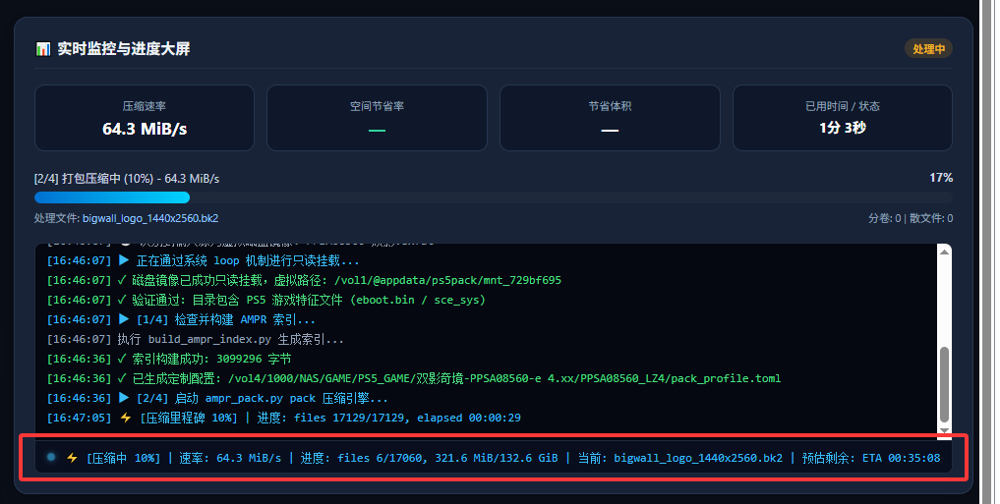
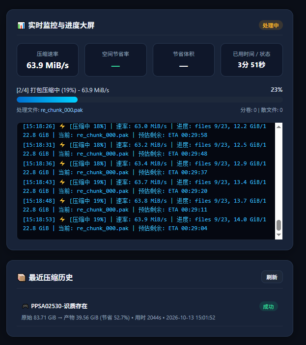
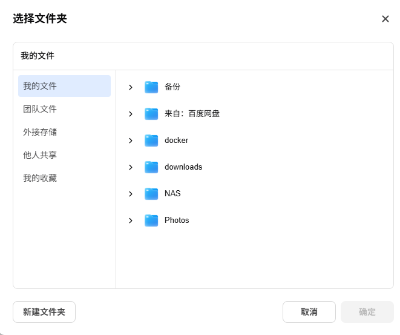
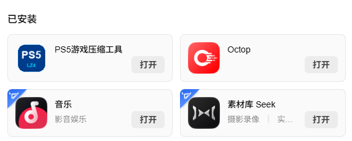
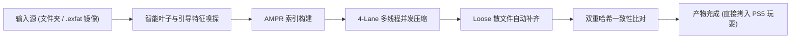

<p align="center">
  
</p>

<h1 align="center">PS5 AMPR LZ4 游戏压缩工具 (fnOS 飞牛版)</h1>

<p align="center">
  <b>专为飞牛私有云 (fnOS) 深度定制的 PlayStation 5 游戏资产高速压缩与部署应用套件</b>
</p>

<p align="center">
  <a href="https://github.com/foxhound1227/ps5pack_fnos/releases"></a>
  <a href="https://www.fnnas.com/"></a>
  <a href="https://github.com/Nazky/Lazy_AMPR"></a>
  <a href="LICENSE"></a>
</p>

---

## 🌟 项目简介

**PS5 AMPR LZ4 游戏压缩工具** 是一款运行于**飞牛私有云 (fnOS)** 原生环境中的高性能 PS5 游戏资产打包与压缩套件。

工具基于社区先进的 **AMPR LZ4 规范** 与多线程调度流式架构，在保证 PS5 主机端秒级透明解压的同时，通常可为大型 PS5 游戏缩减 **40% ~ 60%** 的存储体积（例如实测 83.7 GiB 游戏可大幅压缩至 39.5 GiB，净省 44.1 GiB 宝贵 SSD 空间）。

同时深度集成飞牛 OS 原生微应用生态，提供直观的 Web 控制台、原生文件目录选择器、单文件镜像免解包挂载压缩、实时吞吐大屏以及自适应微胶囊状态监控。

---

## ✨ 核心特性

- 💿 **单文件磁盘镜像直接输入（免解压直接挂载）**
  - 全面支持直接选取 `.exfat`、`.img`、`.iso` 等单文件虚拟磁盘镜像；
  - 基于 Linux 内核原生 `loop` 机制在后台全自动只读挂载，**0 额外临时磁盘开销**，AMPR 引擎以磁盘原生总线速度直接流式读取压缩；
  - 任务完成、终止或异常中断时，在 `finally` 安全管线中**确定性卸载 (`umount`)**，杜绝文件系统锁死与内存泄露。
- 📂 **飞牛原生文件选择器 & 纯净 NAS 目录树**
  - 原生无缝集成飞牛 OS 前端 SDK，点击“浏览”直接呼出系统级“选择文件夹”对话框；
  - 备用浏览器重构为“纯净 NAS 视图”，彻底剔除 Linux 底层系统无权目录，仅展示存储空间卷（如 `存储空间 1`），清晰标亮并呈现 `💿` 镜像单文件。
- ⚡ **AMPR LZ4 4-Lane 高并发压缩引擎**
  - 内置 4-Lane 资产自动分流策略与 `workers` 多线程并发，充分释放 NAS 多核 CPU 与 NVMe/SATA 阵列性能；
  - 压缩等级支持 1~12 级平滑微调（推荐 Level 9，实现速率与压缩率的黄金平衡点）。
- 🛡️ **Loose 启动散文件自动补齐与双重校验**
  - 自动识别并保留 PS5 系统引导必需散文件（`eboot.bin`、`sce_sys/param.json`、`icon0.png` 等），确保产物直接拷贝至主机即可被引导启动；
  - 实时比对原盘文件与已打包分卷数据块的 SHA-256 / 哈希一致性，杜绝解压数据损坏。
- 📊 **现代化实时监控大屏 & 胶囊防撑爆排版**
  - 仪表盘实时呈现瞬时压缩速率（MiB/s）、空间节省率（%）、已节省体积与精确用时；
  - 单行原地刷新升级为**结构化微胶囊徽章（Status Badges）**，窄屏或浮动窗口下**自适应自动折行**，CSS 加装防爆锁，彻底杜绝撑破页面窗口；
  - 历史日志采用每 10% 里程碑智能打点，配备【自动换行 / 横向滚动】切换开关与一键清屏工具。
- 💾 **表单参数与选择路径双重持久化记忆**
  - 关闭应用窗口或刷新页面后，自动恢复上次填写的源目录、输出目录及多线程参数，无需每次重新配置。
- 🎨 **飞牛标准圆角高清微光图标**
  - 采用标准 23% 超椭圆 (Squircle) 连续曲率与全画幅微留白设计，89 阶超采样抗锯齿，与飞牛应用中心桌面图标尺寸 1:1 完美平齐。

---

## 🖼️ 界面预览

### 1. 实时监控与大屏看板
支持实时吞吐速率走字、空间节省率透视、自适应胶囊状态条与里程碑打点：


### 2. 真实压缩成效与历史记录
单款游戏即可节省超过 44 GB 空间（压缩率达 52.7%），历史记录自动持久化留痕：


### 3. 飞牛原生“选择文件夹”对话框集成
无缝调用飞牛 OS 原生文件选择器，交互原生自然：


### 4. 飞牛桌面应用中心图标对齐
89 阶平滑抗锯齿与 PlayStation 微光深邃渐变，尺寸与系统卡片完美贴合：


---

## 📦 安装与部署指南

### 方法一：直接安装发布包（推荐）
1. 在本仓库根目录或 [Releases 页面](https://github.com/foxhound1227/ps5pack_fnos/releases) 下载最新的 [`ps5pack.fpk`](ps5pack.fpk)；
2. 登录飞牛 OS (fnOS) 管理桌面，打开 **应用中心**；
3. 点击右上角 **手动安装** -> **选择文件**，上传 `ps5pack.fpk`；
4. 确认安装权限后点击完成，桌面即会出现 **PS5游戏压缩工具** 图标。

### 方法二：源码编译打包
如果您希望自行构建或二次开发，可在安装了官方 `fnpack` 打包工具的终端中执行：
```bash
# 克隆仓库
git clone https://github.com/foxhound1227/ps5pack_fnos.git
cd ps5pack_fnos

# 使用飞牛官方打包工具构建 .fpk
fnpack build --directory ps5pack
```
构建成功后，将在当前目录生成 `ps5pack.fpk`。

---

## 🚀 使用教程



### 第一步：选择游戏源路径
- **直接选择游戏解包目录**：例如 `/vol1/GAME/艾尔登法环-CUSA...`；
- **或直接选择虚拟磁盘单文件**：例如 `/vol2/PS5_ISOS/双影奇境.exfat` 或 `.img`，应用会自动进行只读挂载嗅探。

### 第二步：选择压缩输出目录
- 选择您的 NAS 共享文件夹或外接移动硬盘目标路径（例如 `/vol1/PS5_COMPRESSED/`）。

### 第三步：调整性能与压缩参数（可选）
| 参数项 | 说明 | 推荐设定 |
| :--- | :--- | :--- |
| **工作线程 (Workers)** | 压缩并行线程数 | 设为 NAS CPU 物理核心数（如 4~8） |
| **压缩级别 (Level)** | LZ4 压缩强度 (1~12) | **推荐 9**（兼顾极速吞吐与高压缩率） |
| **最大分卷 (Max Pack Size)** | 单个 `.pak` 容器最大尺寸 | `16GiB`（适应 exFAT 及各类外置文件系统） |
| **分流车道 (Lanes)** | 并行大文件打包通道数 | `4` |
| **自动 Loose 判定比例** | 若压缩节省率低于该阈值，文件自动转为 loose 不压缩 | `0.05` (5%) |
| **自动补齐 Loose** | 补齐 `eboot.bin`、`sce_sys` 等必要启动文件 | **开启**（PS5 正常开机必需） |
| **产物完整性校验** | 压缩后全量比对哈希与文件结构 | **开启**（确保资产万无一失） |

### 第四步：开始压缩
点击 **⚡ 开始压缩与打包**，大屏将实时展示进度、每 10% 关键里程碑打点与实时吞吐速率。

### 第五步：部署至 PlayStation 5
压缩完成后，输出目录内将包含：
- 若干个分卷压缩包：`re_chunk_000.pak`, `re_chunk_001.pak` 等；
- 索引文件与 loose 引导散文件：`ampr_index.bin`, `eboot.bin`, `sce_sys/` 等。

直接将该输出文件夹拷入移动固态硬盘插入 PS5，或通过 FTP/AMPR 工具部署至主机 `/app0`，即可享受高速免解压即点即玩！

---

## 🛠️ 目录结构规范

```text
ps5pack_fnos/
├── assets/                     # 截图与品牌资源
│   ├── logo.png                # 高清超采样应用图标
│   ├── dashboard.png           # 监控大屏看板
│   ├── history_savings.png     # 历史记录与节省体积
│   ├── picker.png              # 原生文件选择器
│   └── appcenter.png           # 桌面图标效果
├── ps5pack/                    # 飞牛 OS 规范应用包根目录
│   ├── manifest                # 应用元数据清单
│   ├── ICON.PNG                # 64x64 商店图标
│   ├── ICON_256.PNG            # 256x256 桌面高清图标
│   ├── app/
│   │   ├── server/             # Python 后端调度引擎
│   │   │   ├── compressor.py   # 核心调度、loop挂载、日志流式管道
│   │   │   ├── main.py         # HTTP / 统一网关 Socket 服务
│   │   │   ├── engine/         # AMPR LZ4 打包核心
│   │   │   └── static/         # 前端 Web UI (HTML/CSS/JS)
│   │   └── ui/                 # 桌面卡片入口与启动配置
│   ├── cmd/                    # 生命周期契约脚本 (main, install, uninstall)
│   └── config/                 # 权限 (privilege) 与资源访问 (resource)
├── ps5pack.fpk                 # 编译完成的即用型飞牛安装包
├── .gitignore                  # Git 忽略规则
├── LICENSE                     # MIT 开源协议
└── README.md                   # 详细使用说明文档
```

---

## ❓ 常见问题 (FAQ)

<details>
<summary><b>Q1: 使用 .exfat / .img 单文件镜像时，系统会不会耗费几十分钟先解压一次？</b></summary>
<b>完全不会。</b> 本工具采用 Linux 原生 <code>mount -o loop,ro</code> 机制，直接将镜像挂载为虚拟只读文件系统，零额外磁盘空间消耗，AMPR 引擎像读取普通文件夹一样直接流式压缩打包。任务完成后会自动在后台安全卸载。
</details>

<details>
<summary><b>Q2: 为什么我的日志没有频繁滚屏刷屏？</b></summary>
为了避免超长任务时产生数万行无意义的滚屏杂音，本工具采用了<b>“单行微胶囊原地刷新 (In-Place Live Line)” + “每 10% 里程碑智能打点”</b>双模架构，既能秒级看到当前瞬时速率与倒计时，又保证历史日志整洁优雅。
</details>

<details>
<summary><b>Q3: 关闭应用窗口或浏览器标签页，压缩任务会被中断吗？</b></summary>
不会。压缩引擎在 NAS 后台作为独立系统守护进程持续稳定执行，重新打开桌面应用窗口即可自动恢复大屏监控并实时同步进度。
</details>

---

## 🤝 鸣谢与致谢

- 核心打包引擎规范基于 [drakmor/ampr_emu](https://github.com/drakmor/ampr_emu) 与 [Nazky/Lazy_AMPR](https://github.com/Nazky/Lazy_AMPR)；
- 感谢 **飞牛私有云 (fnOS)** 团队提供的优秀 NAS 操作系统与微应用开放生态。

---

## 📄 开源许可证

本项目基于 [MIT License](LICENSE) 协议开源。欢迎提交 Issue 或 Pull Request！
